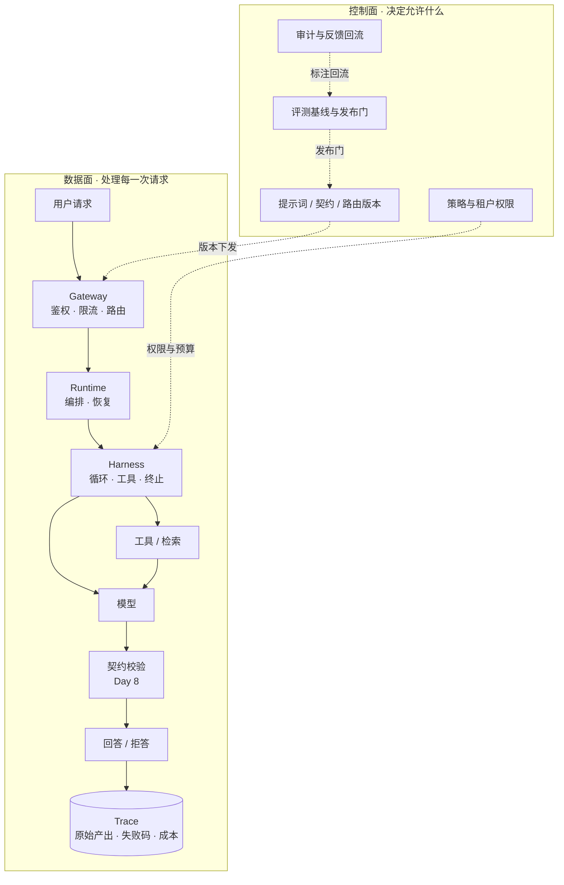
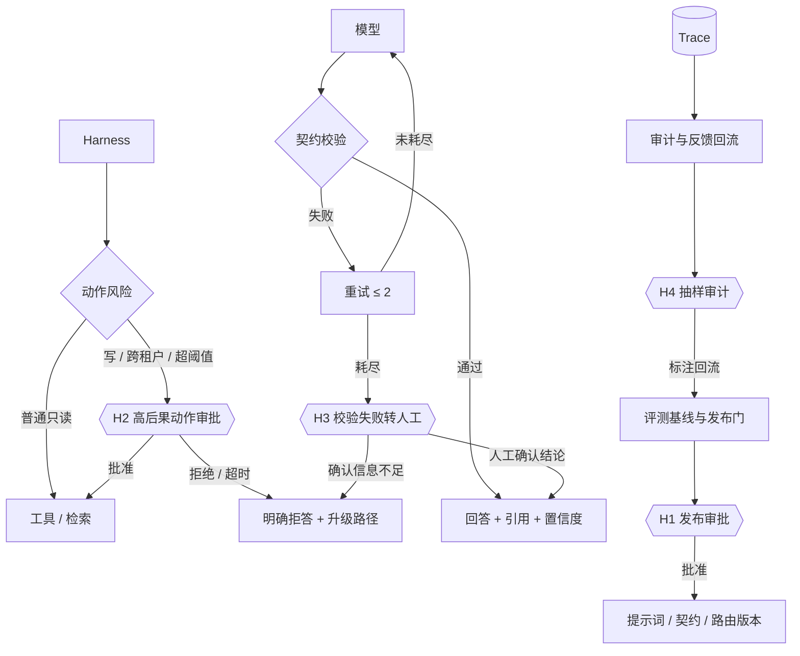

# AI-Native 产品设计：控制面、数据面与人工点位（Day 9）

> 一句话：Demo 证明模型能做什么，产品决定**模型做错时用户看到什么**。能力上限由异常路径决定，不由 demo 的顺利路径决定。

## 1. 三个判断

1. **先选范式，再谈产品形态。** 纯代码 → workflow → agent 的顺序不能反（Day 5）。workflow 的路径由代码定，agent 的下一步由模型定；越自主，越需要控制面与人工点位兜底。
2. **控制面决定「允许什么」，数据面处理「每一次请求」。** 控制面的变更慢、要审批、可回滚；数据面要快、要可观测、失败要有稳定出口。
3. **人工点位不是礼貌确认。** 只拦高后果动作，审批人必须看到原始证据并有真正的拒绝权；否则就是 ThoughtWorks 说的 human-in-the-loop theater。

## 2. 分层图

| 层 | 管什么 | 放什么 | 不放什么 | 失效症状 |
|---|---|---|---|---|
| Gateway | 认证、租户、限流、路由 | API key、配额、模型路由 | prompt、RAG、业务判断 | 全链路不可用；权限失效 |
| Runtime | 编排、超时、恢复 | 任务状态、重试编排、降级链 | 策略裁决、密钥 | 请求卡死或重复执行 |
| Harness | 循环、工具、终止条件 | 工具白名单、步数 / 预算、停止条件 | 供应商 key、租户策略 | 停不下来或过早放弃 |
| 控制面 | 策略、版本、评测、审计 | 权限规则、prompt / 契约 / 路由版本、基线 | 单次请求数据 | 变更无法回滚、审计断链 |
| Trace | 原始产出、失败码、重试、成本 | 每次调用的完整证据 | 用户可见文案 | 事后分不清模型错还是校验错 |

Gateway 不拼 prompt、不做检索，这条在 ADR-0003 已定；控制面与数据面的边界同理：控制面下发版本与权限，数据面只执行。

## 3. 四个人工点位

| 点位 | 触发条件 | 审批人看到什么 | 可做动作 | 超时默认 | 防 theater 检查 |
|---|---|---|---|---|---|
| H1 发布审批 | prompt / 契约 / 模型路由变更 | 变更 diff、评测结果、与基线对照、未达标项 | 批准 / 拒绝 / 要求补测 | 不发布 | 没有评测记录不允许发布 |
| H2 高后果动作 | 写操作、跨租户、超阈值查询、退款等 | 动作参数、影响范围、依据与引用、预算 | 批准 / 拒绝 / 改参数 | 拒绝 | 只拦高风险，不拦普通只读 |
| H3 校验失败转人工 | 重试耗尽仍不合法 | 原始产出、失败码、重试次数、引用来源 | 确认结论 / 确认信息不足 / 补充数据 | 转人工队列，不静默重试 | 必须看到 `raw`，不能只看摘要 |
| H4 抽样审计 | 周期抽样或异常聚集 | 完整 Trace、用户反馈、成本 | 标注 / 标记问题 / 回流评测 | 记录待审 | 抽样结果必须进入基线 |

三条反 theater 规则：

1. **有上下文**：审批人看到原始产出与失败码，不是二手摘要；
2. **有真拒绝权**：拒绝路径必须能改变结果，不是只能点通过；
3. **有默认动作**：超时默认拒绝或转队列，不能无限等待。

风险分级（risk-tiered oversight）比「所有动作都审批」更可持续：全部审批会把注意力耗光，最后变成点通过。

## 4. Demo 到产品的 5 个必补项

| # | 必补项 | 现状 | 缺什么 | 验收信号 |
|---|---|---|---|---|
| 1 | 身份与租户 | Gateway + ADR-0003 已有雏形，API 仍是占位 | 每请求租户上下文、RLS、5 条越权用例 | 跨租户请求全部拒绝并留审计 |
| 2 | 契约与失败码 | Day 8 已完成 Python / TS 双份契约 | 接进 API 与重试链、失败码落 Trace | 四组用例在 CI 常绿 |
| 3 | Trace 与证据 | Langfuse 有延迟 / token / 成本 | 原始产出、失败码、重试次数、路由版本 | 任一失败请求可用一条 Trace 复现 |
| 4 | 成本与配额 | Day 4 有单次成本模型 | 租户预算、限流、重试预算 | 超预算时降级或拒答，不静默继续 |
| 5 | 评测与发布门 | Day 6 基线、Day 7 对照记录 | 金标集、回归门禁、prompt / 契约版本化 | 变差时发布被拦住 |

这五项不是「以后再说」的工程债，而是 Demo 与产品的分界：缺任何一项，异常发生时都只能靠人猜。

## 5. 异常路径：模型答错时用户看到什么

| 失败形态 | 检测层 | 用户看到 | 内部记录 | 禁止 |
|---|---|---|---|---|
| 编造缺失数据 | 上下文 / 契约 | 「当前信息不足：数据只到 2024-11-03，缺少本月记录」 | `MISSING_FIELD` + 原始产出 | 用 0 或猜测值补缺 |
| 算术错误 | 工具 / 代码 | 结论 + 计算式 + 引用，注明「计算由工具执行」 | 工具输入输出 | 只给模型算出的数字 |
| 越权请求 | Gateway / 策略 | 「无法回答：无权访问其他租户数据。请联系数据管理员」 | 403 + 审计事件 | 「再试一次」式模糊回复 |
| 校验失败耗尽 | 契约 | 「结果未通过校验，已转人工核对（编号 …）」 | 失败码 + 重试次数 + `raw` | 把堆栈或错误码直接给用户 |
| 超时 / 超预算 | Runtime | 「已停止：超过本次时限 / 预算」 | 预算事件 + 已完成步骤 | 静默返回半截结果 |
| 工具失败 | Harness | 「数据暂不可用，未使用旧缓存」 | 工具错误 + 调用链 | 拿过期缓存冒充实时结果 |

原则：**用户看到「结论 + 依据 + 下一步」，内部看到「原始产出 + 失败码 + 重试 + 成本」。**

Day 7 的实测是这条原则的证据：1.5B 模型守住三行结构与引用，却把 `108/3600` 稳定算成 `2.8%`。形状正确不代表事实正确；产品不能只展示答案，必须展示计算依据，并把算术下沉到工具。否则用户没有任何线索判断这个 `2.8%` 该不该信。

## 6. 与前后模块的接口

| 模块 | 关系 |
|---|---|
| Day 5 范式 | workflow 越固定，HITL 越少；agent 越自主，H2 / H3 越不可省 |
| Day 7 提示词 | 拒答与升级文案来自 `prompts/system_v1.md`，决定用户看到的第一句话 |
| Day 8 契约 | 失败码是 H3 的触发条件，也是 Trace 的检索键 |
| Day 10 架构 | 本文是输入；`architecture.md` 再展开四层职责、多租户与零信任 |
| ThoughtWorks Radar | LiteLLM / Temporal 在 Trial；agent sandboxing 在 Adopt；risk-tiered oversight 在 Trial；human-in-the-loop theater 在 Caution |

## 7. 自测

1. 哪一层挂了系统还能用？哪一层挂了必须停服？
2. 模型答错但契约校验通过时，用户看到什么？凭什么判断该不该信？
3. 四个点位里，哪些可以自动化、哪些必须保留真人？把 H1 也做成「人人点通过」会怎样？