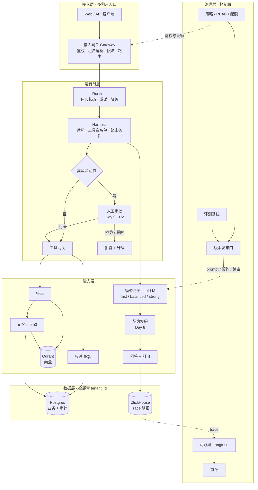
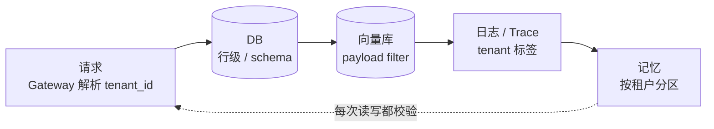

# 企业级 Agent 全景架构（Day 10）

> 一句话：分层不是为了好看，是为了让故障域可隔离。先定「谁唯一负责什么」，再谈部署、扩容和租户隔离。

## 1. 设计原则

1. **单一职责**：每层只做一件事，跨层的判断放回控制面，不在数据面里临时加规则。
2. **简单优先**：纯代码 → workflow → agent（Day 5）。架构图允许 agent 存在，但不代表每个任务都要走 agent。
3. **租户贯穿**：`tenant_id` 从请求进来到日志落盘，每一跳都要带，不能只在入口校验一次。
4. **失败有出口**：高风险动作 fail closed；低风险只读可用 last-known 策略继续，但必须写审计。
5. **控制面与数据面分离**：控制面慢、可审批、可回滚；数据面快、可观测、可降级（Day 9）。

## 2. 目标架构图

两个容易混的「网关」在这里分开：

- **接入网关 Gateway**：请求入口，负责认证、租户解析、限流、路由；不碰 prompt、不做检索。
- **模型网关 LiteLLM**：只负责模型路由、provider key、成本与重试；不承担业务判断（ADR-0003）。

## 3. 四层职责边界表

| 层 | 唯一职责 | 可以 | 不可以 | 故障域 | 当前实现 |
|---|---|---|---|---|---|
| Gateway（接入网关） | 认出「谁在请求」并决定是否放行 | 认证、租户解析、限流、路由、拒绝 | 拼 prompt、做 RAG、写业务数据 | 挂了全链路停服；租户解析错等于隔离失效 | 未实现；ADR-0003 只覆盖模型网关 |
| Runtime | 把一次任务跑完并管住状态 | 任务状态、超时、重试编排、降级、恢复 | 做策略裁决、持有 provider key | 挂了在途任务丢失；有 checkpoint 才能恢复 | `apps/api` 仍是占位 |
| Harness | 把单次模型调用变成有界循环 | 循环、工具白名单、步数 / 预算、停止条件、契约校验 | 持有 key、决定租户权限 | 挂了 agent 任务停；固定 workflow 不受影响 | 未实现 |
| 治理层 | 决定允许什么、记录发生了什么 | 策略与 RBAC、评测、发布门、审计、可观测、配额 | 修改单次请求的数据、绕过 Trace | 挂了数据面可按 last-known 策略继续；高风险动作 fail closed | 只有 Langfuse 与零散基线 |

判据：**一层是否合格，看它能不能在不偷看别层内部状态的情况下完成自己的职责。** Gateway 不知道 prompt，Runtime 不知道 provider key，Harness 不知道租户策略，治理层不碰单次请求数据。

## 4. 支撑层

| 层 | 放什么 | 当前状态 | 备注 |
|---|---|---|---|
| 能力层 · 模型 | LiteLLM 路由：fast / balanced / strong | fast、balanced 已跑通；strong 未接 | 换供应商只改 `infra/litellm/config.yaml` |
| 能力层 · 工具 | 只读 SQL、检索、文档查询 | 未实现 | 工具白名单在 Harness 侧 |
| 能力层 · 记忆 | mem0 + Qdrant 长期记忆，上下文短期记忆 | Qdrant 已起；mem0 未接 | 记忆必须按 tenant 分区 |
| 能力层 · 契约 | Day 8 TaskContract | Python / TS 双份已通过 fixture | 失败码进 Trace，重试在 Runtime |
| 数据层 · Postgres | 业务数据（`dataagent` 库）+ Langfuse 元数据（独立 `postgres` 库） | `dataagent/app` 9 张表已建，RLS 已开 | 云端库未迁移；连接池 `SET LOCAL` 未验证 |
| 数据层 · Qdrant | 向量索引 | 容器已起 | payload 必须带 `tenant_id` |
| 数据层 · ClickHouse | Langfuse trace 明细 | 容器已起 | 日志同样带 `tenant_id` |
| 数据层 · MinIO | Langfuse 对象存储 | 容器已起 | 不直接面向业务 |

## 5. 一次请求的路径

1. **Gateway**：认证 → 解析 `tenant_id` → 限流 → 选路由。
2. **Runtime**：建任务状态，设定超时、重试上限、降级链。
3. **Harness**：判断下一步是调模型还是调工具，检查工具白名单与步数 / 预算。
4. **高风险闸门**：写操作、跨租户、超阈值查询走 H2 审批；拒绝或超时直接进入拒答。
5. **模型 / 工具**：模型经 LiteLLM；工具经只读网关；检索与记忆按 `tenant_id` 过滤。
6. **契约校验**：Day 8 的解析 → Schema → 约束三层；失败进重试，耗尽转人工。
7. **回答**：结论 + 依据 + 引用；不合法输出不进入正式回答。
8. **Trace**：原始产出、失败码、重试次数、路由 / prompt / 契约版本、成本，全部落 Trace。

## 6. 故障域：哪层挂了还能用

| 组件挂了 | 影响 | 可用性策略 | 当前是否单点 |
|---|---|---|---|
| Gateway | 全部请求进不来 | 必须停服；需要多实例或前置 LB | 是 |
| Runtime | 在途 agent 任务丢失 | 有 checkpoint 可恢复；无 checkpoint 只能重提 | 是（无状态存储） |
| Harness | agent 循环停止 | 固定 workflow 不受影响（尚未实现） | 是 |
| LiteLLM | 模型调用全停 | 需要第二路由或降级到模板回答 | 是 |
| Postgres | 业务与审计都不可用 | 必须停服；只读副本只能救读 | 是 |
| Qdrant | 检索不可用 | 降级为「无上下文则拒答」，不拿旧缓存冒充 | 是 |
| ClickHouse / Langfuse | 服务可继续，但 Trace 断链 | 本地缓冲后补写；期间不得发布 | 是 |
| 策略引擎 | 高风险动作无法裁决 | 高风险 fail closed；只读用 last-known 策略 | 未实现 |

面试题「哪一层挂了系统还能用」的答案分两种：**治理层与可观测层可以降级继续；Gateway、数据层、模型网关挂了必须停服。** 说「都能降级」是不诚实的。

## 7. 多租户贯穿（Day 11 预告）

`tenant_id` 至少要在这五跳出现，缺一跳就有一类越权路径：

| 跳 | 带什么 | 校验点 | 当前 |
|---|---|---|---|
| 请求 | header / token 中的租户 | Gateway 解析并写入上下文 | 未实现 |
| DB | 行级 `tenant_id` | RLS 或 schema 隔离 | 未定 |
| 向量库 | payload `tenant_id` | 检索 filter 强制注入 | 未实现 |
| 日志 / Trace | `tenant_id` 标签 | 查询与审计按租户过滤 | 未实现 |
| 记忆 | 分区键 `tenant_id` | 写入与检索双向校验 | 未实现 |

隔离三级（独立库 / 独立 schema / 行级 RLS）在 Day 11 选型；今天只要求架构图上每层都留出这个字段的位置。

## 8. 评测与可观测

- **评测**：`eval/datasets` 与 `eval/scorers` 仍是占位；现有基线来自 Day 6 的环境 / 闭环 / 成本 / 资源四类指标，以及 Day 7 的三组 prompt 对照、Day 8 的四组契约 fixture。
- **发布门**：prompt / 契约 / 模型路由的每次变更，都要有对照记录才能发布（Day 9 H1）。
- **Trace 必带字段**：`tenant_id`、路由版本、prompt / 契约版本、原始产出、失败码、重试次数、成本。
- **可观测不是日志堆**：只存最终结果无法区分「模型错」还是「校验错」；原始产出必须留。

## 9. 现状与差距

| 模块 | 现状 | 差距 | 下一步 |
|---|---|---|---|
| 基础设施 | podman 9 个服务，Day 6 验收 10/10 | 无自启、单机 | Day 15 前后补启动脚本 |
| 模型网关 | LiteLLM fast / balanced | 无 strong、无限流 | Day 16 |
| 接入网关 | 无 | 认证、租户、限流全缺 | Day 11 起 |
| Runtime / Harness | `apps/api` 占位 | 循环、状态、工具全缺 | Day 13–16 |
| 契约 | Day 8 双语言通过 | 未接 API 与重试 | Day 15 |
| 提示词 | `system_v1.md` + 对照记录 | 未版本化进发布门 | Day 13 |
| 记忆 | Qdrant 就绪 | mem0 未接、无租户分区 | Day 14 |
| 评测 | 零散基线 | 无金标集、无 CI | Day 12 之后 |
| 可观测 | Langfuse 可用 | Trace 字段不全 | Day 15 |

## 10. 与前后模块的接口

| 模块 | 关系 |
|---|---|
| Day 9 产品视角 | H2 审批、异常路径文案、控制面 / 数据面定义直接复用 |
| Day 11 多租户 | 本文只留位置；隔离级别、RLS、5 条越权用例在 Day 11 落地 |
| Day 13–16 实现 | Runtime / Harness / 工具 / 记忆按本图分层，不跨层取值 |
| Day 6 基线 | 环境与闭环基线是本架构的最小可运行前提 |

## 11. 自测

1. 哪一层挂了系统还能用？哪一层挂了必须停服？为什么不能都说「可以降级」？
2. 接入网关与模型网关为什么必须分开？合并后谁会拿到不该拿的 key？
3. `tenant_id` 在哪五跳必须出现？缺哪一跳会出哪类越权？
4. 如果把 Harness 的逻辑塞进 Runtime，故障域会怎么变化？